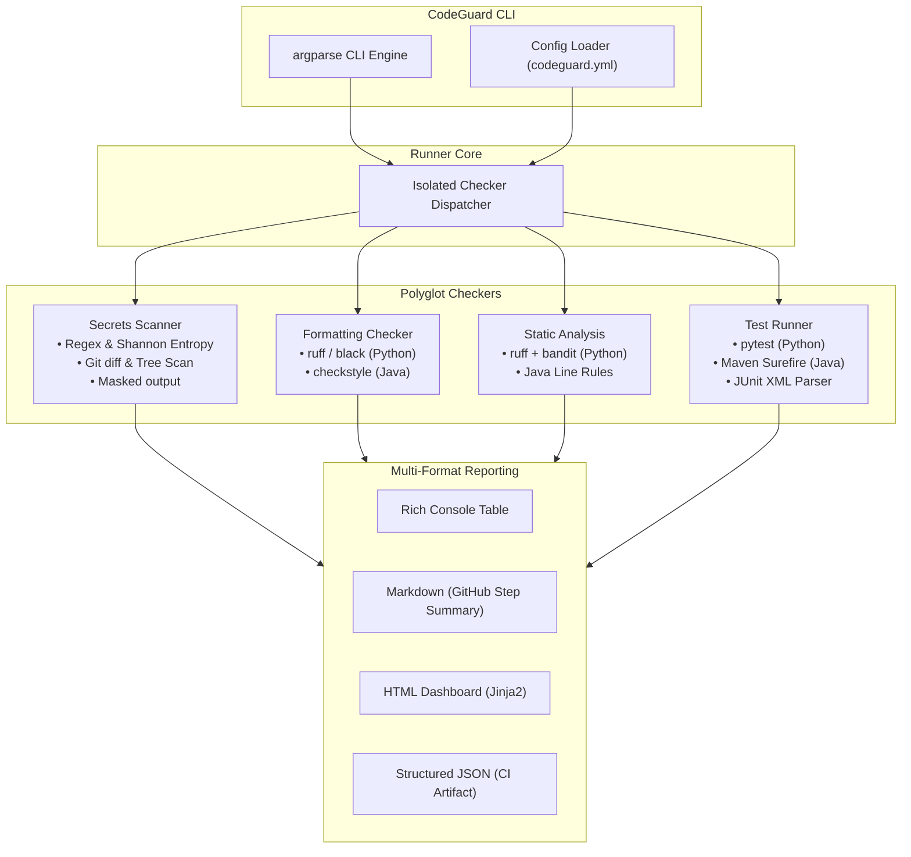

# CodeGuard

[](https://github.com/OWNER/REPOSITORY/actions/workflows/codeguard.yml)

> Automated, polyglot pre-merge quality gate for GitHub repositories.

---

## Problem Statement

Modern software repositories often struggle with fragmented quality checks: linters, security scanners, test runners, and formatters each produce disparate outputs with inconsistent return codes. Furthermore:

1. **Tool Crashes Break Visibility**: If one tool crashes or is missing from an environment, standard CI scripts abort early, masking failures in subsequent checks.
2. **Credential Leaks in CI Logs**: Secret scanning tools frequently echo matched tokens into standard output or summary logs, compromising sensitive credentials.
3. **Multi-Language Friction**: Polyglot projects (such as Python backends paired with Java microservices) require complex, glued-together CI configurations.

**CodeGuard** provides a unified gate that orchestrates code formatting, static analysis, unit test execution, and secrets detection. It guarantees strict crash isolation, zero credential leakage via 4-character masking, and automated reporting across console, Markdown, HTML, and JSON.

---

## Architecture



---

## Quick Start

### 1. Installation

Python 3.11+ is required. Install CodeGuard in editable mode with development dependencies:

```bash
python -m pip install -e ".[dev]"
```

### 2. Basic Usage

Run all enabled checks against the current working directory:

```bash
# Run full gate and output rich console summary
codeguard run --path .

# Generate all report formats (console, report.md, report.html, report.json)
codeguard run --path . --format all

# Run specific checkers with a custom failure threshold
codeguard run --fail-on MEDIUM --only secrets,tests
```

### 3. Exit Codes

CodeGuard uses deterministic exit codes designed for CI/CD automation:

| Exit Code | Meaning | Priority |
| :---: | :--- | :--- |
| `0` | **PASS**: All checks passed and no findings met or exceeded the threshold. | Lowest |
| `1` | **GATE FAILED**: One or more findings met the severity threshold, or a test failed. | Normal |
| `2` | **TOOL ERROR**: A checker crashed or a required binary (`git`, `ruff`, `bandit`, `mvn`) is missing. | **Wins over code 1** |

---

## Configuration Reference

CodeGuard reads configuration from `codeguard.yml` at the repository root. All keys are optional and fall back to safe defaults:

```yaml
# Minimum severity that triggers a gate failure (LOW, MEDIUM, HIGH, CRITICAL). Default: HIGH
fail_on: HIGH

# Toggle individual checks
checks:
  formatting: true
  static_analysis: true
  tests: true
  secrets: true

# Patterns excluded from scanning (glob syntax)
excludes:
  - .git
  - .venv
  - venv
  - __pycache__
  - .pytest_cache
  - target
  - dist
  - build
  - htmlcov
  - "*.egg-info"
  - tests/fixtures
  - sample-java-app/src/demo-bad

# Secrets scanner tuning
secrets:
  entropy_threshold: 4.0

# Formatting preferences
formatting:
  python: ruff  # Choose 'ruff' or 'black'

# Test runner arguments
tests:
  pytest_args: []
  maven_args: []
```

### Ignore Patterns and Inline Suppressions

- **`.codeguard-ignore`**: Gitignore-style skip list for files containing intentional test fakes or mocks.
- **Inline Allow Comments**: Add `# codeguard:allow` (Python/Shell) or `// codeguard:allow` (Java/C/JS) to suppress rules on a single line.

---

## Demo: Triggering Intentional Failures

The repository includes a deliberately flawed Java component under `sample-java-app/src/demo-bad/` that contains formatting issues, empty catch blocks, `System.out.println`, and a fake AWS access key.

To verify that CodeGuard catches every defect, scan that directory directly:

```bash
codeguard run --path sample-java-app/src/demo-bad --fail-on LOW
```

**Expected output:**
- Secrets Scanner catches: `secrets.aws-access-key` (masked to `AKIA***`)
- Static Analysis catches: `java.empty-catch`, `java.system-out`, `java.string-compare-eq`, `java.print-stack-trace`, `java.unused-import`, `java.todo-fixme`
- Formatting catches: `format.ruff` or indentation violations
- Process exits with code `1` (gate failed).

---

## Design Decisions

1. **Crash Isolation via Defensive Execution**:
   Checkers run inside independent execution boundaries (`_invoke`). If a third-party tool crashes or runs out of memory, it is captured as a structured tool error on `CheckResult.error`. The remaining checkers continue unaffected, and exit code `2` is returned so CI jobs clearly distinguish broken infrastructure from code quality failures.

2. **Strict Secret Masking**:
   Any token detected by the secrets scanner is masked using `mask_secret` prior to storage in memory or serialization. Only the first four characters are retained (e.g. `AKIA***`, `ghp_***`), preventing CI job outputs and pull request comments from leaking credentials.

3. **Hybrid Polyglot Architecture**:
   Python checks use fast, modern tools (`ruff`, `bandit`, `pytest`). Java source files are verified using line-level pattern matching for common anti-patterns without requiring a JVM daemon, while full Maven Surefire and Checkstyle validations execute seamlessly whenever `pom.xml` is present.

4. **JUnit XML Normalization**:
   Instead of scraping terminal strings from pytest or Maven, CodeGuard parses standard JUnit XML reports directly. This guarantees 100% accurate extraction of pass, fail, and skipped test counts along with exact assertion failure diagnostics.

5. **Sticky Pull Request Comments**:
   The GitHub Actions workflow uses `actions/github-script` to search for previous CodeGuard comments by marker comment tag. Successive CI runs update the existing PR comment in place, avoiding comment spam across iterative review cycles.
